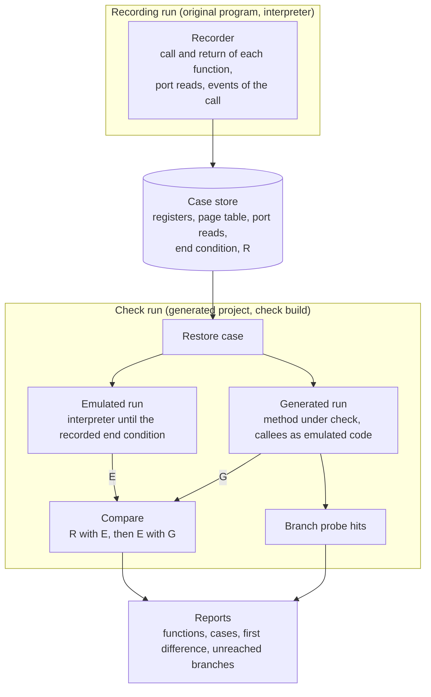

# Generated code checker: design and implementation plan

Design for the feature requested in [issue 2529](https://github.com/OpenRakis/Spice86/issues/2529):
a check of generated C# against the emulated original, one function at a time. This document
proposes the design and the order of work. It contains no code change.

File and line references point at master commit `49af003e`. A statement marked "inferred" was
concluded from the code around it and has not been confirmed by running anything. Section 10 lists
every such statement.

## 1. Summary

A case is the machine state at one recorded call of one function. The checker replays each case
twice: once through the interpreter, once through the function's generated method with every
callee running as emulated code. Both runs write an ordered event log. The checker compares the
logs and the end state, reports the first difference, and reports the branches of the generated
method that no case reached.

The main decisions:

1. Everything the function exchanges with the outside is replayed from the recording: port reads
   are answered from recorded values and port writes are logged and dropped. Device state then
   has no influence on either run, so device snapshots are needed only for functions that depend
   on interrupts or on memory-mapped devices.
2. Each case is replayed through the interpreter before the generated run, and that replay has to
   reproduce the recording. A case that does not reproduce depends on state the case does not
   hold, and gets no verdict.
3. Callees are redirected by a subclass of the generated class that overrides every generated
   method. The method under check calls `base`. Every other method runs the interpreter from its
   own entry address.
4. Registers are compared according to the calling convention the generator computed for the
   method, because the generator removes register and flag writes that no caller reads.
5. Generated code for a check is produced with a generator option that adds branch probes and
   service call notifications and keeps port sequences as single port accesses.
6. The recommended split: the generator option, the service call event, a port interception
   point and an interrupt hold go into Spice86. The recorder, the case store, the replay driver,
   the comparison and the reports start outside, in a project that references Spice86.

## 2. Terms

| term | meaning |
|---|---|
| function | A generated method: one partition of the CFG (`doc/codeGeneratorReadme.md:68`). The original function is the code that partition covers. |
| case | State at the entry of one recorded call of a function: registers, flags, memory, plus what the recording saw during the call. |
| R | The log made while recording the case, in the original run. |
| E | The log of the emulated replay of the case. |
| G | The log of the generated replay of the case. |
| frame region | Stack memory below the stack pointer the function was entered with, on the entry stack segment. |
| check build | Generated code produced with the instrumentation option of section 5.2. |

## 3. Goals and non-goals

### Goals

- For one function and one case, decide whether the generated method agrees with the original,
  and show the first difference with both sides when it does not.
- Check the function alone. A difference inside a callee must not be reported against the caller.
- Work on a whole program: thousands of functions, cases stored at a size that fits on a
  developer disk, a full check that runs unattended.
- Report, per function, the branches of the generated method that no case reached.
- Give the same results through the command line and the MCP server.
- Keep generated output byte-identical when the instrumentation option is off.

### What "agrees" means

For one case, E and G agree when all four hold:

1. Both runs end, at the same address and with the same stack segment and stack pointer.
2. Their port reads, port writes, service calls and calls are equal, event by event and in order.
3. Between each pair of consecutive events of rule 2, every memory byte outside the frame region
   receives the same sequence of values in both runs.
4. At the end, every register and flag is equal, except those the generator's calling convention
   for the method lists as changed and not observed by callers (section 4.7).

A function agrees when every kept case agrees. Agreement is evidence for the recorded inputs and
nothing more: an input no case holds is not checked.

Differences in the frame region and in registers excluded by rule 4 are reported as notes. They
do not make a case disagree. Section 4.7 gives the reason for each exception.

### Non-goals

- Proving equivalence. The check is a differential test over recorded inputs.
- Checking timing. Cycle counts differ between the two runs by construction: the interpreter
  counts one cycle per instruction (`src/Spice86.Core/Emulator/CPU/CfgCpu/CfgCpu.cs:157`),
  generated code one per `CheckExternalEvents`
  (`src/Spice86.Core/Emulator/ReverseEngineer/CSharpOverrideHelper.cs:1537`).
- Checking breakpoint delivery or debugger bookkeeping, which the generator documents as outside
  its contract (`doc/codeGeneratorReadme.md:9-15`).
- Checking hand-written overrides. The case store and the comparison would serve that later, and
  nothing here prevents it, but this plan covers generated methods only.
- Checking protected-mode code.

## 4. Architecture



### 4.1 Facts from master that shape the design

| fact | reference | consequence |
|---|---|---|
| A memory write reaches breakpoints one byte at a time, with the address and `CurrentlyWritingByte`. The width of the access is not visible there. | `src/Spice86.Core/Emulator/Memory/Memory.cs:96-108` | The log holds byte writes. |
| The interpreter and generated code use the same port entry point. | `src/Spice86.Core/Emulator/CPU/CfgCpu/InstructionExecutor/InstructionExecutionHelper.cs:215-227`, `CSharpOverrideHelper.cs:1707-1742` | Ports can be intercepted at `IOPortDispatcher`. |
| A recognized port sequence becomes one device call that does not pass through the dispatcher, for example `AL = Cmos.ReadRegister(0)`. | `src/Spice86.Core/Emulator/ReverseEngineer/CfgCodeGeneration/Ir/Passes/IrDeviceOperations.cs:21-63`, `src/Spice86.Core/Emulator/Devices/Cmos/RealTimeClock.cs:127-132`, golden `tests/Spice86.Tests/Resources/cpuTests/res/GeneratedCode/cmos_ports.pit.ivt.spec.cs.txt:162` | A check build must keep single port accesses, or device calls stay invisible. |
| A service is reached in three ways: the callback instruction of the installed stub, `InterruptCall` to the generated method of that stub, and a direct call of the implementing method. The direct call pushes no interrupt frame and loads no selector or input register. | `src/Spice86.Core/Emulator/InterruptHandlers/InterruptHandler.cs:115-126,150-155`, `CSharpOverrideHelper.cs:1145-1164`, `src/Spice86.Core/Emulator/InterruptHandlers/Dos/DosInt21Handler.cs:1526-1541`, golden `batch_append_redirection.pit.ivt.spec.cs.txt:163-164`, `doc/codeGeneratorLegality.md:510` | One event per service needs a notification for the direct form. Stack bytes of the frame differ between the runs. |
| The generator removes register and flag writes whose value nothing reads. At a return, only the method's outputs count as read. | `doc/codeGeneratorReadme.md:303`, `doc/codeGeneratorReadme.md:573`, golden `cc_register_leaf.spec.cs.txt:171-183` (the `mov SI`/`mov DI` writes are gone) | Registers outside the outputs may differ at the end, and so may the values pushed to the stack. |
| A typed call site calls the C# method itself. An override registered by address is not reached. Only a subclass `override` replaces it. | `doc/codeGeneratorReadme.md:78`, `CSharpOverrideHelper.cs:950-995,1035-1070` | Callees are redirected with a subclass. |
| Generated methods are `public virtual`. The class is `partial` and takes its function dictionary as a constructor argument. | golden `cc_register_leaf.spec.cs.txt:34,52,92,103` | The redirect subclass needs no change to generated code. |
| Hardware interrupts are delivered at two places, and both ask `DualPic.ComputeVectorNumber`. | `CfgCpu.cs:228-249`, `CSharpOverrideHelper.cs:1549`, `src/Spice86.Core/Emulator/Devices/ExternalInput/DualPic.cs:187-209` | One gate in the PIC holds delivery for both runs. |
| The emulation loop pumps input and device events. `CfgCpu.ExecuteNext` does not. Generated code pumps both itself in `CheckExternalEvents`. | `src/Spice86.Core/Emulator/VM/EmulationLoop.cs:130-135`, `CSharpOverrideHelper.cs:1543-1545` | A driver that calls `ExecuteNext` directly sees no device events. The generated run does unless they are held. |
| DOS keeps open files in C# objects. | `src/Spice86.Core/Emulator/OperatingSystem/DosFileManager.cs:66` | Restoring memory does not restore DOS. A service that depends on that state makes a case fail its self-check. |
| Decoded instructions stay current through memory write breakpoints on their bytes. `WriteRam` writes to the devices directly and triggers none. | `src/Spice86.Core/Emulator/CPU/CfgCpu/Feeder/CurrentInstructions.cs:88-91`, `Memory.cs:64-69` | Restoring a case has to invalidate decoded instructions. |
| Reading the video window goes through the VGA device and loads its latches. | `src/Spice86.Core/Emulator/Devices/Video/VideoMemory.cs:41-53`, `src/Spice86.Core/Emulator/Devices/Video/Renderer.cs:90` | Case capture skips the video window. |

### 4.2 Recording cases

The recorder runs with the original program in the interpreter, with no overrides installed. The
run should use the cycle clock (`--InstructionTimeScale`,
`src/Spice86/Spice86DependencyInjection.cs:259-261`) with a fixed `--ClockStartTime`, so that a
recording can be repeated.

**Where a case starts and ends.** `FunctionHandler.Call` sees every emulated call with its call
type, entry address, expected return address and stack address
(`src/Spice86.Core/Emulator/Function/FunctionHandler.cs:82-103`). `FunctionHandler.Ret` matches
each return against the call stack and already tells an aligned return from a redirected one and
from an unwind to an outer frame (`FunctionHandler.cs:185-226`). A recorder inside Spice86
subscribes to those two points (section 5.5). A recorder outside Spice86 has no such
subscription today. It sets an execution breakpoint on each function entry, reads the return
address with `PeekReturnAddressOnMachineStackForCurrentFunction` (`FunctionHandler.cs:156-159`)
and sets a second breakpoint there. It sees aligned returns only and drops the other calls.

**What a case holds.**

| part | content |
|---|---|
| entry | Function entry address, call type, all 32-bit general registers, segment registers, IP, flags, `State.Cycles`. |
| memory | The page table of section 4.3. |
| port reads | Port, width and value of every port read during the call, in order, made outside hardware interrupt handlers. |
| end condition | Address the call ended at, stack segment and stack pointer there, and the kind: aligned return, redirected return, unwind. |
| R | The event log of the call (section 4.6), or its hash when the log exceeds a size limit, and the registers and flags at the end. |
| marks | Whether a hardware interrupt was delivered during the call, and which services the call used. |

Events that happen while the CPU is in a deeper execution context than the call
(`CfgCpu.cs:66-67`, `CfgCpu.cs:247`) belong to a hardware interrupt handler and are left out of R
and of the port read list.

**Which calls are kept.** A program calls some functions millions of times. The recorder captures
a function's calls number 1, 2, 4, 8 and so on, and keeps at most K of them (default 8),
preferring calls from a return address not seen yet, then calls whose R hash is new. A call that
has not ended when the run stops, or that exceeds an event limit, is dropped and counted.

### 4.3 Case store

Storing 1 MiB of memory per case does not scale: 3000 functions with 8 cases each would take
about 25 GiB. Memory is stored as pages instead.

- Memory is split into 4 KiB pages. Each page is identified by a hash of its content and stored
  once, compressed, in an append-only pack file with an index.
- A case holds a page table: one hash per page. Tables are stored as a difference from the
  previous case of the same recording.
- Captured ranges: `0x00000-0x9FFFF` and `0xC0000` up to the end of the high memory area. The
  video window `0xA0000-0xBFFFF` is skipped (section 4.1). Memory behind the EMS page frame
  (`src/Spice86.Core/Emulator/InterruptHandlers/Dos/Ems/ExpandedMemoryManager.cs:160`) and XMS
  memory are not captured.
- The store header holds a format version, the Spice86 version, the program checksum
  (`src/Spice86.Core/CLI/Configuration.cs:56`) and the settings that change the machine: memory
  options, A20, EMS, XMS, UMB, handler segment, CPU model. The checker refuses a store whose
  header does not match the check run.
- Hashing uses SHA-256 and compression uses the base class library, so the store adds no package.

Capture cost is one read of the captured ranges and one hash pass per kept call. With the
selection rule of section 4.2 a function is captured about `log2(calls)` times, so the cost does
not grow with the length of the run.

Size estimate, inferred without a measurement: a page table is about 4 KiB before the difference
encoding, and a kept case adds the pages that changed since the previous capture. At 20 new
pages per case and 24,000 cases that is under 2 GiB before compression.

### 4.4 Restoring a case

The check run starts the same program with the same settings in the generated project's process
and stops before the program's first instruction. For each case the driver:

1. Writes the case's pages over the captured ranges. Pages whose hash equals the one already
   restored are skipped.
2. Invalidates decoded instructions for the pages it wrote. Two ways exist today: write the
   changed bytes through the `Memory` indexer so the breakpoints of
   `CurrentInstructions.cs:88-91` fire, or call `CfgCpu.Clear()` (`CfgCpu.cs:252-255`). Which
   one is cheaper has to be measured.
3. Sets registers, flags, CS:IP and `State.Cycles` (`src/Spice86.Core/Emulator/CPU/State.cs:322`).
4. Clears `LastExecuted` and `NodeToExecuteNextAccordingToGraph` of the current execution
   context (`src/Spice86.Core/Emulator/CPU/CfgCpu/Linker/ExecutionContext.cs:38,43`). Without
   this the CPU continues with the node it had planned before the restore
   (`src/Spice86.Core/Emulator/CPU/CfgCpu/Feeder/CfgNodeFeeder.cs:72-82`) and links the last
   node of the previous case to the entry of this one (`CfgNodeFeeder.cs:55-70`).
5. Installs the port replay of section 4.6 with the case's port reads, and holds hardware
   interrupts.

The check run must not export a CFG or generate code afterwards: replaying cases adds executions
to the graph that the program never performed in that order.

### 4.5 The emulated run and its bounds

The driver calls `CfgCpu.ExecuteNext()` in its own loop. No override is installed in the check
run (section 4.6), so the interpreter executes every instruction of the function and of its
callees. The driver does not pump the device scheduler or the input queue.

The run ends when CS:IP equals the recorded end address and the stack segment and pointer equal
the recorded ones. The driver tests this between `ExecuteNext` calls. On the hot path one call
runs a whole block (`CfgCpu.cs:171-192`), and a block ends at its return or jump, so the test
runs right after each control transfer.

| way the call ended in the recording | what the recorded end condition holds |
|---|---|
| `ret`, `retf`, `iret` to the call's return address | That address, entry SP plus 2, 4 or 6. |
| `ret n`, `retf n` | The same address, with SP raised by `n` more. The recorded SP is exact, so `n` needs no special rule. |
| far return from a near call, after the caller pushed CS | The far address, entry SP plus 4. |
| redirected return: the callee rewrote its return address | The address it landed on (`FunctionHandler.cs:194-213`). |
| unwind: the return matched an outer frame | The outer return address and the stack pointer there (`FunctionHandler.cs:215-221`). The cases of all frames the unwind popped end at this point. |

The run also ends, with no verdict, when it executes more than a multiple of the recorded
instruction count, when a port read does not match the next recorded read, or when the machine
stops.

E must equal R, compared with the rules of section 4.7 at full strictness. When it does not, the
case is reported as not reproducible with its first difference, and G is not run. This is the
guard for everything a case does not hold: DOS state, device state behind memory, interrupts.

### 4.6 The generated run and callee redirection

**How generated code calls.** A generated method reaches other code in five ways:

| shape | example | reference |
|---|---|---|
| untyped call through a delegate field | `NearCall(cs, ip, calleeEntry)` | `CSharpOverrideHelper.cs:812-834,872-894` |
| typed call of the method | `(AX, CarryFlag) = NearCall(cs, ip, () => callee(EAX, DS))` | `CSharpOverrideHelper.cs:950-995` |
| transfer to another partition | `return Other(loadOffset);` | `doc/codeGeneratorReadme.md:68` |
| interrupt | `InterruptCall(cs, ip, 0x21)`, which looks the handler up in the instance's own dictionary | `CSharpOverrideHelper.cs:1145-1153,1253-1260` |
| direct service call | `(AX, CarryFlag) = Dos.ReadFile(0, 1, DS, 0x0120)` | `CSharpOverrideHelper.cs:601` |

The first four end in a `virtual` method of the generated class: delegate fields are assigned
lambdas that call the methods (golden `cc_register_leaf.spec.cs.txt:57-63`).

**The redirect subclass.** One subclass per check build overrides every generated method. Each
override asks the driver whether its method is the one under check and no activation of it is
running yet.

- If so, it calls `base` with its arguments.
- Otherwise it stores its arguments into the registers they are named after, sets CS:IP to the
  method's entry address, runs the interpreter until the stack pointer rises above its value at
  that moment, and returns. A typed method returns its outputs read from the registers. An
  untyped method returns `Returned` (`CSharpOverrideHelper.cs:1028`), because the emulated
  return has already popped the return address.

A recursive call of the method under check therefore runs as emulated code: the check covers
one activation.

After the override returns, the call helper validates the return exactly as it does for a
generated callee. `ExecuteCallEnsuringSameStack` runs the override chain, which returns when
CS:IP is the expected return address and throws `CallStackUnwindException` when control landed
somewhere with no override (`CSharpOverrideHelper.cs:1269-1285`, `FunctionHandler.cs:286-317`).
Redirected returns listed at the call site are accepted by `IsRedirectedReturn`
(`CSharpOverrideHelper.cs:1842-1844`). None of this changes.

A callee that raises the stack pointer above its entry value before it returns stops the
override's loop early. The helper then finds CS:IP away from the expected return address and
throws, and the driver takes over as described under "The run" below.

The subclass is one file of generated source. It needs each method's entry address, its entry
offsets for a multi-entry method and the registers behind its parameters and return values.
The check build's manifest (section 5.2) carries them.

**Setup.** The check run starts Spice86 with no override supplier, so the machine's function
catalogue holds no override and the interpreter never enters generated code by itself. The
driver constructs the redirect subclass with a dictionary of its own, as the direct call test
does (`tests/Spice86.Tests/GeneratedCodeMachineTest.cs:178-197`).

**The run.** The driver restores the case, takes the override registered at the entry address
from the instance's dictionary and invokes it and the action it returns. Then:

- If CS:IP and the stack match the recorded end condition, the run has ended.
- If the method threw `CallStackUnwindException`, the exception's target is where the method
  left to (`CSharpOverrideHelper.cs:1065-1069`). The driver continues as below.
- If control is elsewhere, the method transferred out of generated code, for example through a
  jump action. The driver continues in the interpreter until the end condition, under the same
  limits as the emulated run, and logs the point where it took over. From that point both runs
  execute emulated code, so the rest of the call is not a check of the generated method, and the
  report says so.
- Any other exception ends the run and is the verdict. `FailAsUntested`
  (`CSharpOverrideHelper.cs:1447-1455`) means the method reached a path the discovery run never
  took.

A limit on the generated run is enforced through a cycle breakpoint, which `CheckExternalEvents`
triggers (`CSharpOverrideHelper.cs:1537-1543`). Whether every generated loop contains such a
check is inferred from the generated goldens and `doc/codeGeneratorLegality.md:58`. A loop with
no check cannot be interrupted from inside the process, so the check run should also run under a
wall-clock limit set by its caller.

### 4.7 Event log and comparison rules

**Events.**

| event | fields | source in the emulated run | source in the generated run |
|---|---|---|---|
| `W` | physical address, byte | memory write breakpoint on every address (`Memory.cs:102-107`) | the same breakpoint |
| `PR` | port, width, value | port interception (`IOPortDispatcher.cs:55-100`) | the same |
| `PW` | port, width, value | port interception (`IOPortDispatcher.cs:103-148`) | the same |
| `SVC` | vector, selector, input values | service call event (section 5.1) | service call event, including direct calls |
| `CALL` | target address, SS:SP, registers | `FunctionHandler.Call`, or an execution breakpoint on each known entry | the redirect override for the first level, then as in the emulated run |
| `END` | address, SS:SP, registers, flags | driver | driver |

Port reads are answered from the case's list in order. A read whose port or width differs from
the next recorded read ends the run. Port writes are logged and not passed to the device. No port
access reaches a device during a check, so the check leaves device state alone.

The log is a binary stream of fixed-size records. Past a size limit a run keeps a rolling hash
and the last N events, so a difference is still detected and its position still known.

**Rules.** Events other than `W` split a log into segments.

1. Non-write events are compared pairwise in order. Kind and fields must be equal.
2. Inside a segment, writes are compared per address: each address must receive the same
   sequence of values. The order of writes to different addresses inside one segment is free.
   The reason is that the two runs write equal bytes in a different order in places: the
   interpreter pushes a far return address offset first (`src/Spice86.Core/Emulator/CPU/Stack.cs:345-351`),
   the call helper pushes CS first (`CSharpOverrideHelper.cs:889-890`). Nothing can observe the
   order inside a segment, since interrupts are held and every port access starts a new segment.
3. Writes to the frame region are compared the same way, and their differences are notes.
   Two documented properties of generated code put different bytes there: a direct service call
   builds no interrupt frame, which the repository pins with
   `BuiltInOperationWithoutFrameDependencyLeavesStackBytesUntouched`
   (`tests/Spice86.Tests/GeneratedCodeMachineTest.cs:249`), and a register whose write was
   removed as dead is pushed with another value by an emulated callee that saves it. Memory
   below the stack pointer is overwritten by the next interrupt in the original as well.
4. `SVC` inputs are the values of the registers in the service contract's `Reads`
   (`src/Spice86.Core/Emulator/InterruptHandlers/Common/Contracts/InterruptServiceEntry.cs`),
   with the stack pointer normalized to the caller's value. A service with an unknown contract
   compares all registers.
5. `CALL` compares the target and SS:SP. Registers are compared for the callee's inputs when the
   manifest lists them, and for all registers otherwise.
6. `END` compares the address, SS and SP. A register or flag in the method's outputs must be
   equal. One in its changes and outside its outputs is a note. Any other must be equal. The
   sets come from `IrCallingConventions`, which defines outputs as the changes a caller may
   still observe (`doc/codeGeneratorReadme.md:573`).

**Verdicts for a case.**

| verdict | meaning |
|---|---|
| agree | No difference. |
| agree with notes | Only differences that rules 3 and 6 classify as notes. |
| disagree | A difference under rules 1 to 6. The report holds the event index, both events and the events before them. |
| generated run failed | The method threw, with the exception and the log up to it. |
| not reproducible | E differs from R. The report holds the first difference. |
| not run | The emulated run hit a limit, or the case's end kind is not supported by the recorder in use. |

A strict mode turns notes into differences, for a user who plans to call the method from
hand-written code that reads other registers.

### 4.8 Coverage

The check build wraps the condition of every printed branch in a probe call that records the
outcome and returns it (section 5.2). After the cases of a function have run, the checker reads
the hits and reports, per function:

- branch outcomes no case produced, each with its site id, the address of the instruction it came
  from and the printed condition;
- `switch` values no case selected;
- arms that end in `throw FailAsUntested`. Discovery never took these, so cases from the same
  recording cannot reach them. They are listed apart.

Hits are counted only while the method under check runs as generated code, which the redirect
subclass guarantees for every other method. Coverage describes the generated method. A branch the
generator folded away has no site.

### 4.9 Reporting through the command line and MCP

The checker runs inside the generated project's process, because it needs the compiled generated
code. The scaffolded `Program.cs` forwards its arguments to `Spice86.Program.Main`
(`src/Spice86.Core/Emulator/ReverseEngineer/CfgCodeGeneration/GeneratedProjectScaffolder.cs:126`),
so new options are reachable from a generated project without changing the scaffold.

Proposed options, next to the existing ones in `Configuration.cs`:

| option | effect |
|---|---|
| `--RecordCases <directory>` | Record cases during a normal run. |
| `--CasesPerFunction <n>` | K of section 4.2. |
| `--CheckGeneratedCode <directory>` | Run the checker on a case store instead of running the program. |
| `--CheckFunction <segment:offset>` | Check one function and write both logs of each case. |
| `--CheckStrict` | Treat notes as differences. |

Output goes to a `check` directory in the store: `functions.tsv` (per function: cases, verdict
counts, branch outcomes reached and total, first difference), `cases.tsv` (per case), a
`summary.json`, and one trace file per case that disagrees. The process exits with a non-zero
code when a case disagrees, so the check can gate a build.

MCP tools, registered like the existing ones
(`src/Spice86.Core/Emulator/Mcp/EmulatorMcpTools.cs:95`) or from outside through
`IMcpToolSupplier` (`doc/mcp.md:257-273`):

| tool | result |
|---|---|
| `check_list_functions` | Functions with verdict counts and coverage. |
| `check_function` | Runs the cases of one function and returns the verdict of each and the first difference. |
| `check_case_events` | A window of E and G around an event index of a case. |
| `check_unreached_branches` | The unreached branch outcomes of one function. |

The tools work on a case store in a check run. They are not offered in a live program session:
a check overwrites memory and registers, and a service the function calls would change DOS state
under the running program.

## 5. Changes to Spice86's core

The issue names four. Reading the code turned up two smaller ones, 5.5 and 5.6.

### 5.1 One event per DOS or BIOS service call

**Today.** The emulated program reaches a service through the callback instruction of the
installed stub (`InterruptHandler.cs:115-126`). The handler's `Run()` reads the selector and calls
`Run(int index)` (`DosInt21Handler.cs:2276-2282`, `InterruptHandler.cs:150-155`). Generated
`InterruptCall` ends in the same `Run()` through `RunFromOverriden` (`CSharpOverrideHelper.cs:1092-1100`,
`src/Spice86.Core/Emulator/InterruptHandlers/Common/Callback/CallbackHandler.cs:45-47`,
`InterruptHandler.cs:208-213`). A direct call goes to the implementing method and passes neither.

**Proposal.**

```csharp
public interface IServiceCallObserver {
    void OnServiceCall(in ServiceCall call);
}

public readonly record struct ServiceCall(
    byte Vector, int? Selector, InterruptServiceEntry Entry, bool Direct,
    IReadOnlyList<(CpuValues Register, uint Value)> Inputs);
```

- `InterruptHandler.Run(int index)` raises the event for handlers that dispatch on a selector.
  A handler with a single service raises it from the callback that `WriteAssemblyInRam`
  registers. The exact place for single-service handlers with their own stub is to be settled
  in the pull request.
- For a direct call, the check build prints a notification before the call with the same
  argument expressions: `ServiceCalled(0x21, 0x3F, 0, 1, DS, 0x0120);`. `CSharpOverrideHelper`
  maps the arguments to registers through `InterruptServiceEntry.Inputs` and raises the same
  event. The printed arguments are register reads, constants and string decodes, which have no
  effect when evaluated twice (`doc/codeGeneratorReadme.md:295`).
- The implementing method raises nothing, so a stub that calls its own implementation
  (`DosInt21Handler.cs:1528-1532`) reports once.

**Classes touched.** `InterruptHandler`, `CSharpOverrideHelper`, `CSharpStatementPrinter`
(the direct call is printed near line 204), `Machine` or `InstalledInterruptHandlers` to hold
the observer.

**Alternatives.**

| alternative | trade-off |
|---|---|
| A generator option that prints `InterruptCall` for every site | No runtime API. The checked code then differs from the shipped code around every bound site, because the direct call has narrower effects that feed constant propagation and dead write removal (`doc/codeGeneratorLegality.md:510`). |
| Execution breakpoints on the callback addresses (`Callback.InstructionAddress`) plus a source rewrite for direct calls | Works without a core change. The rewrite depends on the printed text. |
| A notification inside each implementing method | Covers hand-written callers too. Touches every service method, and a stub would report twice unless guarded. |

**Risk.** Performance: one null check per service call. Determinism: none, the observer only
reads. Generated output is unchanged when the option is off.

**Later extension.** Replacing a service by its recorded effects, so that file I/O reproduces.
It needs a form of the hook that can skip the service, and a rule for mapping recorded register
values to the return value of a direct call. Section 9 asks whether this is wanted.

### 5.2 A generator option for check builds

**Today.** The generator takes two booleans (`CfgCSharpGenerator.cs:46-63`) and is constructed in
one place for dumps (`src/Spice86/Spice86DependencyInjection.cs:500`). Statement probes exist in
the test project as a Roslyn rewrite (`tests/Spice86.Tests/GeneratedCodeProbes.cs:89-109`), and
Spice86.Core does not reference Roslyn.

**Proposal.** An options record replaces the booleans:

```csharp
public sealed record GeneratorOptions {
    public bool CollectCensuses { get; init; }
    public bool Verify { get; init; }
    public bool BranchProbes { get; init; }
    public bool ServiceCallNotifications { get; init; }
    public bool DeviceOperations { get; init; } = true;
    public bool Manifest { get; init; }
}
```

A `--GeneratedCodeCheckBuild` option sets the last four for the dump.

- **Branch probes.** A pass over the structured method AST, after structuring and before
  printing, wraps the condition of each `IfElseNode`, `WhileNode`, `DoWhileNode`,
  `PreTestLoopNode` and `ConditionalValueNode` in `Branch(site, condition)` and the value of each
  `SwitchNode` in `Selector(site, value)`. Both are methods of `CSharpOverrideHelper` that record
  and return their argument. A condition combined from several instructions gets one probe per
  operand. Running the pass on the final AST leaves every earlier pass with the same input, so
  the check build's methods differ from the shipped ones by the wrappers only.
- **Service call notifications.** Section 5.1.
- **Device operations.** When off, `IrDeviceOperations` is skipped and every port access prints
  as a single access. This is the one place where a check build's code differs from the shipped
  code in more than added calls. The pass is a late rewrite inside one block
  (`IrDeviceOperations.cs:28-29,46-47`), and the report names the methods it would have changed.
- **Manifest.** A JSON file next to the generated sources: per method its name, entry addresses
  with the segment field each uses, the entry offsets of a multi-entry method, the registers
  behind parameters and return values, the inputs, outputs and changes sets, and its probe sites
  with kind, instruction address and printed text.

**Classes touched.** `CfgCSharpGenerator`, `IrMethodEmitter` or `MethodBodyEmitter` for the new
pass, the pass pipeline, `CSharpStatementPrinter`, `CSharpOverrideHelper`, `CfgCSharpDumper`,
`Configuration`, `Spice86DependencyInjection`.

**Alternatives.**

| alternative | trade-off |
|---|---|
| Probes inserted in the IR before structuring | Coverage maps to CFG edges. The probes change what the structuring passes see, so `ConditionCombiner` and `IrIfConversion` produce different code than in the shipped build. |
| The Roslyn rewrite of the tests, moved to a tool | No generator change. Needs Roslyn where the checker runs, probes statements instead of branch outcomes, and breaks when the printed shapes change. |
| Coverage taken from the emulated run's executed instructions | No generator change. It measures the original's branches. It cannot see a branch the generator merged or removed. |
| No manifest: reflection over the compiled class and parsing of the `/// <summary>` lines | No new output file. Entry addresses then come from method names, and the convention sets from comment text. |

**Risk.** With the option off the output must stay byte-identical, which the 460 generated source
goldens check (`tests/Spice86.Tests/GeneratedCodeMachineTestRunner.cs:272-280`). With it on, a
probe adds one call per branch. Determinism is unaffected: a probe returns its argument.

### 5.3 Device state snapshot and restore

**Today.** The PIC and the PIT expose read-only snapshot records
(`src/Spice86.Core/Emulator/Devices/ExternalInput/PicSnapshot.cs:21-33`, `DualPic.cs:251`,
`src/Spice86.Core/Emulator/Devices/Timer/PitChannelSnapshot.cs:69-79`,
`src/Spice86.Core/Emulator/Devices/Timer/PitTimer.cs:882`). Nothing restores them. The state
dump writes registers and memory and reads back only execution data, symbols, breakpoints and
the CFG (`src/Spice86.Core/Emulator/StateSerialization/EmulationStateDataReader.cs:27-68`).

**Where the design needs it.** With ports replayed, three kinds of function remain out of reach:
one that waits for an interrupt handler to change memory, one that reads planar video memory, and
one whose service calls read device state. Everything else is checked without this change, which
is why it comes last in the plan.

**Proposal.** Each device gets a pair `TState CaptureState()` and `void RestoreState(TState)`
over an immutable record, starting from the two existing records. A `Machine` method captures and
restores a chosen set. Order of work: PIC, then PIT with the scheduler entries it owns
(`src/Spice86.Core/Emulator/VM/DeviceScheduler/DeviceScheduler.cs:61`), then VGA registers and
planes. Sound Blaster and DMA follow only if cases need them.

**Alternatives.**

| alternative | trade-off |
|---|---|
| Replay at the port boundary only (this design's default) | No core change. The three kinds of function above stay unverifiable. |
| Run the program again from its start to each case | No snapshot code. Needs a fully repeatable run, costs the run's length per batch of cases, and the check itself disturbs the state the next case would start from. |
| Check during the recording run, where the first run is the real execution | No snapshot for the emulated side. The second run must then leave DOS state alone, which needs service replay, and cases cannot be reused after regenerating. |

**Risk.** Restoring has to re-arm scheduled events, and a snapshot that misses a field gives a
wrong state without an error. The self-check of section 4.5 catches that for the cases it
affects. No cost when unused.

### 5.4 Holding hardware interrupts

**Today.** Delivery happens in `CfgCpu.DeliverExternalInterrupt` (`CfgCpu.cs:228-249`) and in
`CheckExternalEvents` (`CSharpOverrideHelper.cs:1546-1553`). Both call
`DualPic.ComputeVectorNumber` (`DualPic.cs:187-209`).

**Proposal.** `DualPic` gets a hold: `IDisposable HoldDelivery()`. While held,
`ComputeVectorNumber` returns `null` before it reads or clears `IrqCheck`, so requests stay
pending, and it records the cycle, CS:IP and line of each request it would have delivered. That record is
the answer to "where does the original enable interrupts": a case with suppressed deliveries is
one the original could have been interrupted in. The same hold makes `CheckExternalEvents` skip
its input and scheduler pumping (`CSharpOverrideHelper.cs:1543-1545`), so the generated run sees
the same absence of device events as a driver loop around `ExecuteNext`.

**Classes touched.** `DualPic`, `CSharpOverrideHelper`.

**Alternatives.**

| alternative | trade-off |
|---|---|
| Mask every line with `SetIrqMask` (`DualPic.cs:615`) | No core change, and enough while all port accesses are intercepted, since the program can then neither read nor change the mask. It does not stop the generated run from pumping the scheduler, and it gives no record of suppressed deliveries. |
| Clear the interrupt flag | Changes the flags the function pushes and returns. |

**Risk.** Performance: one boolean test per delivery attempt. Determinism: a hold that is not
released leaves the machine without interrupts, which the disposable scope prevents. With the
hold, a function that waits for an interrupt never ends. The limits of section 4.5 end the run.

### 5.5 Call and return observer (found while reading)

`FunctionHandler` already classifies every call and return (section 4.2) and exposes none of it.
Two observer methods, `OnCall(FunctionCall)` at `FunctionHandler.cs:90-91` and
`OnReturn(FunctionCall, SegmentedAddress? actualReturn, kind)` in `Ret`
(`FunctionHandler.cs:185-226`), let a recorder end cases on redirected returns and unwinds and
give the `CALL` event without one breakpoint per function. Cost: a null check per call and
return. Without it, a recorder sees aligned returns only.

### 5.6 Port interception (found while reading)

`ReplaceIOPortHandler` (`IOPortDispatcher.cs:50-52`) replaces one port's handler, and the
dictionary of registered handlers is `internal` (`IOPortDispatcher.cs:33`). A tool outside
Spice86 can install a replay handler but cannot read the handler it replaced, cannot cover a
port nothing is registered for, and learns of a write through a breakpoint that carries the port
only (`IOPortDispatcher.cs:105`). Proposal: an optional interceptor on the dispatcher, asked
first by the six read and write methods, which can answer a read and consume a write. Cost: a
null check per port access. The smaller alternative is a public read accessor for the
registered handlers.

## 6. Where each part lives

| part | in Spice86 | outside | recommendation |
|---|---|---|---|
| Service call event (5.1) | needed for the direct form | breakpoints cover the stub form only | Spice86 |
| Generator option and manifest (5.2) | the generator owns the shapes | only by rewriting printed source | Spice86 |
| Device snapshots (5.3) | devices hold private state | not possible | Spice86, last |
| Interrupt hold (5.4) | small | `SetIrqMask` covers the replay design | Spice86 |
| Call and return observer (5.5) | small | aligned returns only | Spice86 |
| Port interception (5.6) | small | partial | Spice86 |
| The four fixtures and the tests of the changes above | they pin what the checker depends on | | Spice86 |
| Recorder and case store | | possible | outside first |
| Replay driver and redirect subclass | uses `internal` members if inside | possible with public API | outside first |
| Log comparison, verdicts, reports | | has no Spice86 dependency beyond types | outside first |
| MCP tools | | through `IMcpToolSupplier` | outside first |
| Function inventories and project bookkeeping | | project specific | outside |

**Recommendation.** Take the middle path of the issue. The core changes are small and general:
each is useful to anyone who debugs generated code, with or without a checker. The checker starts
as a separate project that references the Spice86 package, as generated projects do
(`GeneratedProjectScaffolder.cs:94-101`). Its dependence on generated shapes is carried by the
manifest and pinned by fixtures in Spice86's test suite, so a generator change that breaks the
checker fails in Spice86's CI. If the maintainers want
the checker inside, the move is a namespace change once its formats have settled.

**The smallest core subset that lets the checker live outside:** the generator option of 5.2,
including the direct service call notification of 5.1, plus the port interceptor of 5.6. With
those three an outside checker handles every call that returns to its call site. 5.5 adds
redirected returns and unwinds. 5.4 adds the suppressed delivery record. 5.3 adds the functions
that depend on interrupts and planar video.

## 7. Known limits

| limit | behaviour |
|---|---|
| Self-modifying code | Writes to code bytes are memory writes and are compared. A case whose code bytes differ from the ones the generator saw makes the generated method fail its signature checks (`CSharpOverrideHelper.cs:1469-1513`), reported as a failed generated run. Restoring a case must invalidate decoded instructions (section 4.4). |
| Timing-dependent functions | A function that polls a port sees the recorded values in the recorded order. A function that waits for an interrupt handler to change memory never ends under the hold and gets no verdict, until 5.3 exists and interrupts can be delivered at recorded points. Anything keyed on the cycle count differs between the runs. |
| Functions that never return | No end condition, so no case. Counted in the recording report. |
| Hardware interrupt handlers | Entered asynchronously in an execution context of their own (`CfgCpu.cs:245-248`). The first version records no cases for them. Handlers entered by an `int` instruction are functions with a six-byte frame and are covered. |
| Entries reached only by a jump | No call, so no case. |
| Stack switches | A function that returns on another stack segment, or never restores the pointer, does not meet its end condition. |
| `hlt` | Under the hold the interpreter waits forever (`CfgCpu.cs:96-101`). The limit ends the run. |
| DOS and BIOS state outside memory | Services run for real in each replay. A case that reads a file or depends on handle state usually fails its self-check. Service replay (5.1) would lift this. |
| Memory-mapped devices | The video window, the EMS page frame and XMS memory are not in a case. A function that reads them fails its self-check, or passes when the bytes happen not to matter. |
| Device operations | A check build keeps single port accesses, so the rewrite to device calls is not checked. |
| Breakpoint contract | The check relies on generated memory writes reaching `Memory`'s byte setter and generated port accesses reaching `IOPortDispatcher`. Master does both, apart from device operations. The generator's stated non-goals (`doc/codeGeneratorReadme.md:9-15`) do not promise it. |
| Dead values | A register outside the method's outputs may differ and is a note. A hand-written caller that reads it would see the difference. Strict mode reports it. |
| Untested arms | `FailAsUntested` arms cannot be reached by cases from the recording that produced the code. |
| Recorded inputs only | A function that agrees on eight cases can still differ on a ninth. Coverage shows which branches the cases reached, and nothing about the values they reached them with. |
| x87 state | Not read for this design. If the emulator holds x87 state, a case does not. |

## 8. Implementation plan

Each milestone is one pull request with its tests. M1 to M5 change Spice86. M6 to M11 are the
checker and apply wherever it lives.

Tests build on what the repository has: assembly sources in
`tests/Spice86.Tests/Resources/cpuTests/asmsrc` assembled by `regen-asm-bins.sh`, fixtures
declared in `AsmFixtureCatalog` (`tests/Spice86.Tests/AsmFixtures/AsmFixtureCatalog.cs:556`),
runs through `AsmFixtureRunner.RunEmulated` and `RunWithOverride`
(`tests/Spice86.Tests/AsmFixtures/AsmFixtureRunner.cs:77,102`), generation, compilation and
golden comparison through `GeneratedCodeMachineTestRunner`, and in-memory compilation of edited
sources through `GeneratedOverrideCompiler.CompileSupplier`, as
`TypedMethodOverrideComputesFromItsArgumentsNotTheRegisters` does
(`tests/Spice86.Tests/GeneratedCodeMachineTest.cs:87-133`).

| milestone | content | tests |
|---|---|---|
| M1 Fixtures | Four assembly fixtures, each calling its function several times with different inputs: `check_leaf` (register and memory results, one conditional branch), `check_callee` (near and far callees, one `ret n`), `check_ports` (reads and writes on a latch port, as `ioports` does with `LatchIoPortHandler`), `check_dos` (one service that prints a direct call and one that keeps `InterruptCall`). | Each joins the generated catalogue, so `GeneratedCodeMachineTestRunner` checks its oracle, its machine goldens and its generated source golden. `GeneratedCodeDifferentialReport` reports each as identical. |
| M2 Service call event | `IServiceCallObserver` and its two raise points for emulated and stub calls. | On `int_service_calls` and `check_dos`: one event per executed `int`, with the same sequence in the emulated run and the override run for sites that keep `InterruptCall`. A unit test that a stub calling its implementation reports once. |
| M3 Generator options | `GeneratorOptions`, branch probes, service call notification for direct calls, the device operation switch, the manifest, the command line option. | All existing goldens unchanged with the option off. New goldens for the check build of the four fixtures. A test that every `Branch` site of a check build is listed in the manifest. A test on `check_dos` that the emulated and override runs give equal service event sequences, direct call included. A test on `cmos_ports` that a check build prints no device call. A port of `GeneratedCodeProbesTest` to the new probes. |
| M4 Port interception and interrupt hold | The dispatcher interceptor and `DualPic.HoldDelivery`. | `IOPortDispatcherTests`: an interceptor answers reads and consumes writes for registered and unregistered ports, and removal restores the old behaviour. On `externalint.pit`: under the hold no handler runs in the emulated and the override run, the suppressed delivery is recorded, and the request is delivered after release. |
| M5 Call and return observer | The two observer methods on `FunctionHandler`. | On `cc_stack_frames`, `redirectedreturn` and `callstackunwind`: the observer reports aligned returns, a `ret n`, a redirected return and an unwind where each fixture performs one. |
| M6 Event log and comparison | Record format, the rules of section 4.7, verdicts. No emulator dependency. | Unit tests on synthetic logs, one per rule: a reordered far return push agrees, an overwritten value disagrees, a frame region difference is a note, a register outside the outputs is a note and a difference in strict mode. |
| M7 Recorder and case store | Case capture, selection, page store. | On `check_leaf`: the expected number of cases, a round trip through the store, and a store size that grows by changed pages only. A header mismatch is refused. |
| M8 Emulated replay | Restore, the driver loop, port replay, the R against E self-check. | All four fixtures reproduce. A case made not reproducible on purpose, by changing a memory byte the function reads after capture, is reported with its first difference. A function that loops is ended by the limit. |
| M9 Generated run | The redirect subclass, the generated run, E against G. | The four fixtures agree. Mutants of each fixture's generated source, compiled with `CompileSupplier`, disagree at the expected event: a changed constant, a removed memory write, two swapped port writes, a changed service selector, a callee called with a wrong argument. A mutant inside a callee does not make the caller disagree. `callstackunwind` ends through the unwind path. |
| M10 Coverage and reports | Probe hits, the TSV and JSON files, the command line options, exit codes. | On `check_leaf` with a case set that takes one side of its branch only: the other outcome is reported with its instruction address. Report files compared with goldens. |
| M11 MCP tools | The four tools of section 4.9. | Tests in the style of `McpServerToolStateTests` against a case store of `check_callee`. |
| M12 Device snapshots (optional) | PIC and PIT capture and restore. | Capture, change through ports, restore, compare with the first capture. A fixture whose function waits for a timer tick, checked once interrupts can be delivered at recorded points. |
| M13 Service replay (optional) | Skipping a service and applying its recorded effects. | A fixture that reads a file twice reproduces. |

## 9. Open questions for the maintainers

1. Does the checker belong in Spice86, or outside on top of the core changes? Section 6 recommends
   outside first.
2. For the service call event: the observer of 5.1, or a generator option that prints
   `InterruptCall` for every site?
3. Is a check build acceptable as a separate generator output, given that it differs from the
   shipped code by probe calls, notifications and unmerged port sequences? Would you prefer that
   device operations raise an event instead of being switched off?
4. In a check build, would you guarantee that memory writes and port accesses of generated code
   go through `Memory` and `IOPortDispatcher`? The documented non-goals leave this open.
5. Is the reading of `IrCallingConventions` in rule 6 right: a register in a method's changes and
   outside its outputs may hold any value at a return?
6. Is a manifest file an acceptable generator output, and who owns its schema?
7. Is the call and return observer of 5.5 acceptable on `FunctionHandler`?
8. Do you want device snapshots (5.3) at all, and if so for which devices first?
9. Do you want service replay, which needs a hook that can skip a service?
10. Should `check_*` fixtures be new, or should the checker's tests reuse `cc_register_leaf`,
    `cc_call_shapes`, `ioports` and `int_service_calls`?
11. Where should a case store live relative to `--RecordedDataDirectory`?

## 10. What was not verified

- That every loop of a generated method contains a `CheckExternalEvents`. The goldens show one at
  each method entry, and `doc/codeGeneratorLegality.md:58` mentions one at a loop head.
- That calling `CfgCpu.ExecuteNext` from a driver outside `EmulationLoop.RunLoop` has no further
  precondition than `SignalEntry` (`CfgCpu.cs:197-204`) and the context reset of section 4.4.
- That `CfgCpu.Clear()` is safe to call between cases.
- The size estimates of section 4.3.
- That the final method AST is the right place for the probe pass, and that wrapping a condition
  disturbs no later step such as label placement. The node types were read; the passes after
  structuring were not.
- Where a handler with a single service and its own stub should raise the service event.
- That no generated statement writes memory or a port by a path other than the `Memory` indexers
  and `IOPortDispatcher`, apart from device operations. The helper methods and several goldens
  were read; the whole printer was not.
- How a hardware interrupt handler's execution context behaves when its code is run from a
  restored case.
- Whether the emulator holds x87 state.
- `doc/codeGeneratorReadme.md:70` describes single-entry methods as referenced through an
  `Entry(M)` cache. The goldens show delegate fields assigned in the constructor instead, and
  this design relies on what the goldens show.
